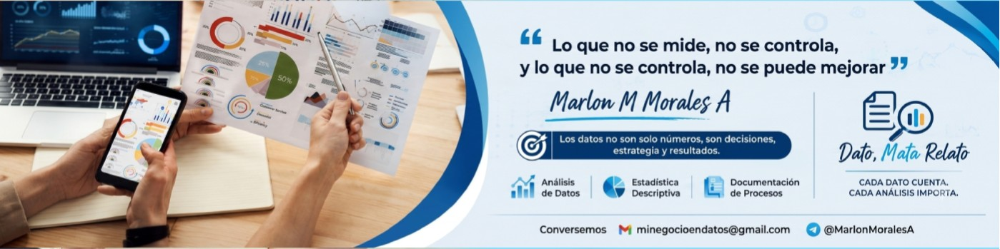

  <h1 align="center">¡Hola, soy Marlon Mauricio Morales Arango! 👋</h1>
  
<b>Analista de Datos | Auditor Interno SGI (HSEQ) | Documentador de Procesos</b>

<!-- Banner Principal -->

  

<!-- Badges de Contacto y Redes -->

  
  
  
  

 

## 📌 Sobre mí

> *"Lo que no se mide, no se controla, y lo que no se controla, no se puede mejorar."*

Soy **Tecnólogo en Producción Industrial** y **Tecnólogo en Gestión Administrativa (ITM)**, con más de 9 años de experiencia como Coordinador de Estadísticas (Descriptivas), Auditor Interno de Calidad y Líder de Procesos[cite: 7, 8]. Mi enfoque profesional une la estrategia, el cumplimiento de estándares y la optimización de recursos económicos de las organizaciones[cite: 7].

- 📈 **Análisis de Datos para la Gestión:** Transformo datos en decisiones inteligentes, estrategia y resultados[cite: 3, 10].
- 🛡️ **Auditorías Internas HSEQ:** Especialista bajo normas ISO 9001:2015, ISO 14001:2015 e ISO 45001:2018 (SGS), enfocadas en la mejora continua mediante el ciclo PHVA[cite: 8, 10].
- 🗂️ **Documentación de Procesos:** Gestión documental avanzada y estructuración de flujos de trabajo basados en el ciclo PHVA[cite: 8, 10].
- 🎯 *Dato, Mata Relato:* Cada dato cuenta, cada análisis importa[cite: 3].

 

---

## 🎓 Formación Académica y Certificaciones Destacadas

- **Auditor Interno en Sistemas de Gestión Integrados HSEQ (ISO 9001, 14001, 45001)** – SGS (2025)[cite: 8].
- **Tecnólogo en Gestión Administrativa** – ITM (2020)[cite: 8].
- **Tecnólogo en Gestión de la Producción** – SENA (2012)[cite: 8].
- **Certificación de Competencia Laboral (Nivel Avanzado)** en Organización de Archivos de Gestión – SENA (2024)[cite: 8].
- **BootCamp de Análisis de Datos** – MinTIC & Universidad Distrital (2023)[cite: 8].

 

---

### ⚙️ GitHub Analytics

  
  

 

  <i>"Transforme sus procesos en activos, sus auditorías en oportunidades y sus datos en inteligencia de negocio."</i>[cite: 10]

